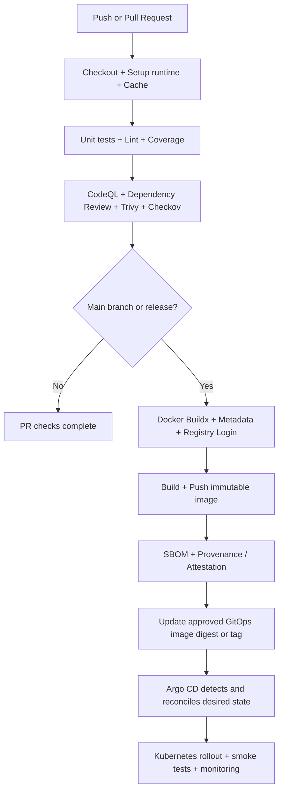

# GitHub Actions — Must-Read Reference for DevOps, Platform & SRE Engineers

> **Last reviewed:** October 12, 2026  
> **Audience:** Engineers working with GitHub Actions, Python, Docker, AWS, Terraform, Kubernetes, Helm, GitOps, observability and software supply-chain security.  
> **Purpose:** A practical, repo-friendly cheat sheet for designing and reviewing production CI/CD workflows.

## Contents

1. [Top 25 GitHub Actions](#top-25-github-actions)
2. [How the actions fit into a pipeline](#how-the-actions-fit-into-a-pipeline)
3. [Ready-to-adapt workflow examples](#ready-to-adapt-workflow-examples)
4. [Security and reliability checklist](#security-and-reliability-checklist)
5. [Learning plan](#learning-plan)
6. [Other tools worth knowing](#other-tools-worth-knowing)
7. [Quick links](#quick-links)

## Top 25 GitHub Actions

This is a **practical priority ranking**, not an audited ranking by installation count. Version tags evolve; check the linked repositories and release notes before adoption, and pin vetted actions to full commit SHAs for production.

| # | Action | Primary purpose | Priority |
|---:|---|---|---|
| 1 | [`actions/checkout`](https://github.com/actions/checkout) | Check out repository source onto the runner | Critical |
| 2 | [`actions/setup-python`](https://github.com/actions/setup-python) | Configure Python and pip caching | Critical |
| 3 | [`actions/setup-node`](https://github.com/actions/setup-node) | Configure Node.js and package-manager caching | Critical |
| 4 | [`actions/cache`](https://github.com/actions/cache) | Reuse dependency/build caches across runs | Critical |
| 5 | [`actions/upload-artifact`](https://github.com/actions/upload-artifact) | Persist build outputs, logs and test reports | Critical |
| 6 | [`actions/download-artifact`](https://github.com/actions/download-artifact) | Retrieve artifacts from earlier jobs | Critical |
| 7 | [`docker/setup-buildx-action`](https://github.com/docker/setup-buildx-action) | Enable Buildx, multi-platform builds and advanced caching | Critical |
| 8 | [`docker/login-action`](https://github.com/docker/login-action) | Sign in to GHCR, ECR, Docker Hub and other registries | Critical |
| 9 | [`docker/build-push-action`](https://github.com/docker/build-push-action) | Build and publish container images | Critical |
| 10 | [`docker/metadata-action`](https://github.com/docker/metadata-action) | Generate image tags, labels and OCI metadata | High |
| 11 | [`aws-actions/configure-aws-credentials`](https://github.com/aws-actions/configure-aws-credentials) | Obtain short-lived AWS credentials through OIDC | Critical |
| 12 | [`aws-actions/amazon-ecr-login`](https://github.com/aws-actions/amazon-ecr-login) | Authenticate to Amazon ECR | High |
| 13 | [`hashicorp/setup-terraform`](https://github.com/hashicorp/setup-terraform) | Install/configure the Terraform CLI | Critical |
| 14 | [`azure/setup-helm`](https://github.com/azure/setup-helm) | Install Helm for linting, packaging and deployments | High |
| 15 | [`azure/setup-kubectl`](https://github.com/azure/setup-kubectl) | Install kubectl for Kubernetes operations | High |
| 16 | [`github/codeql-action`](https://github.com/github/codeql-action) | Static analysis for supported languages | Critical |
| 17 | [`aquasecurity/trivy-action`](https://github.com/aquasecurity/trivy-action) | Scan image, filesystem and IaC risks | Critical |
| 18 | [`bridgecrewio/checkov-action`](https://github.com/bridgecrewio/checkov-action) | Detect IaC policy/security misconfigurations | High |
| 19 | [`anchore/sbom-action`](https://github.com/anchore/sbom-action) | Generate a software bill of materials (SBOM) | High |
| 20 | [`actions/attest`](https://github.com/actions/attest) | Create artifact attestations, including provenance | High |
| 21 | [`codecov/codecov-action`](https://github.com/codecov/codecov-action) | Report and track test coverage | High |
| 22 | [`softprops/action-gh-release`](https://github.com/softprops/action-gh-release) | Create GitHub Releases and attach artifacts | High |
| 23 | [`actions/github-script`](https://github.com/actions/github-script) | Automate GitHub API tasks in JavaScript | High |
| 24 | [`actions/dependency-review-action`](https://github.com/actions/dependency-review-action) | Check dependency changes in pull requests | High |
| 25 | [`dorny/paths-filter`](https://github.com/dorny/paths-filter) | Run only jobs affected by changed paths | Specialized |

**Corrections to the original discussion:** `semantic-release` is a CLI tool, **not** a GitHub Action; it is listed under complementary tools below. The current GitHub-maintained attestation action is `actions/attest`, which is preferred over the older `actions/attest-build-provenance` wrapper. The dependency review action's canonical repository is `actions/dependency-review-action`.

### Which matter most for this stack?

- **Python projects:** checkout → setup-python → cache → test → upload-artifact → CodeQL/Trivy → Codecov.
- **Docker / GHCR:** setup-buildx → login → metadata → build-push → Trivy → attest/SBOM.
- **AWS / Terraform:** configure-aws-credentials (OIDC) → setup-terraform → `fmt` / `validate` / `plan` → policy gates → approved `apply`.
- **Kubernetes / Helm:** setup-helm → chart lint/test → image publishing → update GitOps manifests → Argo CD reconciliation.
- **Monorepos:** paths-filter to avoid rebuilding services unrelated to a particular PR.

## How the actions fit into a pipeline



**GitOps principle:** If Argo CD owns reconciliation, prefer a workflow that publishes an image and updates the **GitOps source of truth**. Avoid having both `kubectl apply` in CI and Argo CD independently manage the same resources. Updating an image in a registry **alone** does not tell Argo CD to deploy it; a GitOps repository change or a deliberately configured image-updater mechanism is required.

## Ready-to-adapt workflow examples

> These are examples, not fully provisioned turnkey production configurations. `@vN` major-version references are easier to read while learning; pin third-party actions to vetted **full commit SHAs** in production. Confirm runner compatibility and current action versions before using them.

### Example 1: Python tests and coverage (`.github/workflows/python-ci.yml`)

```yaml
name: Python CI

on:
  push:
  pull_request:

permissions:
  contents: read

jobs:
  test:
    runs-on: ubuntu-latest
    steps:
      - name: Checkout
        uses: actions/checkout@v7

      - name: Set up Python
        uses: actions/setup-python@v7
        with:
          python-version: '3.13'
          cache: pip

      - name: Install dependencies
        run: |
          python -m pip install --upgrade pip
          pip install -r requirements.txt
          pip install pytest pytest-cov

      - name: Test with coverage
        run: pytest --cov=. --cov-report=xml

      - name: Upload coverage report
        if: always()
        uses: actions/upload-artifact@v4
        with:
          name: coverage-xml
          path: coverage.xml
          if-no-files-found: warn
```

**Notes:** `cache: pip` needs a matching dependency/lock file. Use a pinned dependency lockfile for more reproducible builds. `if: always()` ensures a generated report is uploaded even when tests fail.

### Example 2: Docker image to GitHub Container Registry (`.github/workflows/container.yml`)

```yaml
name: Container Build

on:
  push:
    branches: [main]

permissions:
  contents: read
  packages: write

jobs:
  publish:
    runs-on: ubuntu-latest
    steps:
      - uses: actions/checkout@v7

      - uses: docker/setup-buildx-action@v4

      - name: Login to GHCR
        uses: docker/login-action@v4
        with:
          registry: ghcr.io
          username: ${{ github.actor }}
          password: ${{ secrets.GITHUB_TOKEN }}

      - name: Generate image tags
        id: meta
        uses: docker/metadata-action@v6
        with:
          images: ghcr.io/${{ github.repository }}
          tags: |
            type=sha
            type=raw,value=latest,enable={{is_default_branch}}

      - name: Build and push
        id: build
        uses: docker/build-push-action@v7
        with:
          context: .
          push: true
          tags: ${{ steps.meta.outputs.tags }}
          labels: ${{ steps.meta.outputs.labels }}
          cache-from: type=gha
          cache-to: type=gha,mode=max
```

**Notes:** For promotion to production, prefer an image **digest** (`sha256:...`) instead of a mutable `latest` tag. PRs from forks should run **build/test without push**. Before publishing, add security scanning and release/environment protection as needed. Make sure your repository/org permits GHCR package publishing.

### Example 3: AWS OIDC (`.github/workflows/aws-identity.yml`)

```yaml
name: AWS Identity Test

on:
  workflow_dispatch:

permissions:
  contents: read
  id-token: write

jobs:
  identity:
    runs-on: ubuntu-latest
    steps:
      - name: Authenticate with AWS through OIDC
        uses: aws-actions/configure-aws-credentials@v6
        with:
          role-to-assume: ${{ secrets.AWS_ROLE_ARN }}
          aws-region: us-west-2

      - name: Verify assumed identity
        run: aws sts get-caller-identity
```

**Prerequisite:** Configure the GitHub OIDC identity provider and a narrowly scoped IAM role trust policy in AWS. Prefer limiting trust to a named repository, branch and/or GitHub environment. `id-token: write` permits requesting an OIDC token; it is **not** itself an AWS authorization grant.

### Example 4: Terraform validation (`.github/workflows/terraform-validate.yml`)

```yaml
name: Terraform Validate

on:
  pull_request:
    paths:
      - 'ec2-instances/**'
      - '.github/workflows/terraform-validate.yml'

permissions:
  contents: read

jobs:
  validate:
    runs-on: ubuntu-latest
    defaults:
      run:
        working-directory: ec2-instances

    steps:
      - uses: actions/checkout@v7

      - uses: hashicorp/setup-terraform@v4
        with:
          terraform_version: '1.14.6'

      - run: terraform fmt -check -recursive
      - run: terraform init -backend=false
      - run: terraform validate
```

**Notes:** `terraform init -backend=false` is suitable for syntax/provider initialization and validation, **not** for a remote-state-backed `terraform plan` or `apply`. For plan/apply, configure and authorize the remote backend, implement concurrency/environment protection, and avoid automatically applying untrusted pull requests. The Terraform CLI version above is an illustration—align it with the project's `.terraform-version` and provider lockfile.

### Example 5: Helm chart validation

```yaml
- uses: azure/setup-helm@v4
- name: Lint Helm chart
  run: helm lint helm/k8s-network-monitor
- name: Render Helm templates
  run: helm template monitor helm/k8s-network-monitor --namespace monitoring > /tmp/rendered.yaml
```

**Notes:** `helm lint` and `helm template` don't prove that a deployment will succeed. Also validate rendered Kubernetes manifests and run rollout checks in a test cluster where appropriate.

## Security and reliability checklist

- [ ] Give `GITHUB_TOKEN` the minimum required `permissions` at the workflow/job level.
- [ ] Prefer **OIDC** over static cloud access keys.
- [ ] Pin external actions to **full commit SHAs** in production; review upstream changes before bumping.
- [ ] Enable Dependabot or Renovate for action updates and dependency updates.
- [ ] Protect release environments with approvals and branch restrictions.
- [ ] Avoid exposing write credentials or secrets to untrusted fork pull requests.
- [ ] Avoid checking out and executing untrusted PR code inside privileged `pull_request_target` workflows.
- [ ] Protect remote Terraform state, enforce state locking, and scope IAM roles separately for plan/apply.
- [ ] Separate CI validation from deploy/promotion; require appropriate controls before production changes.
- [ ] Treat generated artifacts, cache inputs, and third-party scripts as potential untrusted supply-chain surfaces.
- [ ] Use immutable image digests for workload promotion and record SBOM/provenance when appropriate.
- [ ] Use concurrency controls for deployment workflows to prevent overlapping promotions.
- [ ] Add smoke tests, rollout status checks, and observability after deployment.
- [ ] Keep logs useful but avoid printing secrets, credentials or sensitive payloads.
- [ ] For self-hosted runners, implement isolation, ephemeral execution where possible, runner patching, and network restrictions.

## Learning plan

A suggested hands-on sequence for Python + infrastructure + Kubernetes projects:

- [ ] **Phase 1 — Foundations:** `checkout`, `setup-python`, `cache`, upload/download artifacts; run `pytest` with coverage.
- [ ] **Phase 2 — Container build:** Docker Buildx, metadata, GHCR login, build/push; use digest-based tags and layer caching.
- [ ] **Phase 3 — Quality gates:** CodeQL, Trivy, Checkov, dependency review, coverage, SBOM and attestations.
- [ ] **Phase 4 — AWS / IaC:** OIDC trust, Terraform `fmt`, `init`, `validate`, restricted plan/apply workflows.
- [ ] **Phase 5 — Kubernetes/GitOps:** Helm lint/template, update GitOps manifests, Argo CD sync, smoke tests and rollbacks.
- [ ] **Phase 6 — Advanced operations:** Reusable workflows, environment approvals, path filtering, concurrency and secure self-hosted runners.

### Project-specific practice ideas

**`platform-inspector`**

- Python matrix tests (e.g., supported Python versions)
- Ruff or another linter, pytest coverage, CodeQL, dependency checks
- Artifact upload for test outputs and coverage reports

**`k8s-network-monitor`**

- CI: pytest → lint → security checks → build image → scan image
- Release: publish immutable image to GHCR with digest + provenance/SBOM
- Deployment: update GitOps source of truth → Argo CD reconciles → verify service health

**`terraform-aws`**

- PR: Terraform format, validate and policy checks
- Authorized branches: AWS OIDC → Terraform plan
- Production: environment approval → narrowly scoped apply with remote state/locking

## Other tools worth knowing

These are important **workflow tools, not necessarily GitHub Actions**:

| Tool | Use |
|---|---|
| [`semantic-release`](https://github.com/semantic-release/semantic-release) | Semantic versioning and release automation CLI |
| [`pytest`](https://docs.pytest.org/) | Python tests |
| [`ruff`](https://docs.astral.sh/ruff/) | Fast Python linting and formatting |
| [`helm`](https://helm.sh/) | Kubernetes packaging, linting and deployment |
| [`kubectl`](https://kubernetes.io/docs/reference/kubectl/) | Kubernetes operations |
| [`terraform`](https://developer.hashicorp.com/terraform) | Infrastructure as Code |
| [`cosign`](https://github.com/sigstore/cosign) | Signing and verifying artifacts/containers |
| [`Argo CD`](https://argo-cd.readthedocs.io/) | GitOps-based continuous deployment |
| [`google/osv-scanner-action`](https://github.com/google/osv-scanner-action) | Optional additional dependency vulnerability scanning action |

## Quick links

- [GitHub Actions documentation](https://docs.github.com/en/actions)
- [GitHub Actions security hardening](https://docs.github.com/en/actions/security-for-github-actions/security-guides/security-hardening-for-github-actions)
- [GitHub's secure use guidance](https://docs.github.com/en/actions/how-tos/security-for-github-actions/security-guides/security-hardening-for-github-actions)
- [GitHub Actions Marketplace](https://github.com/marketplace?type=actions)
- [GitHub OIDC to AWS](https://docs.github.com/en/actions/how-tos/secure-your-work/security-harden-deployments/oidc-in-aws)
- [GitHub reusable workflows](https://docs.github.com/en/actions/how-tos/sharing-automations/reuse-workflows)
- [Docker GitHub Actions](https://docs.docker.com/build/ci/github-actions/)
- [GitHub artifact attestations](https://docs.github.com/en/actions/concepts/security/artifact-attestations)

---

**Maintenance tip:** Revisit this reference every few months: action release majors, Node runtime requirements, hosted runner versions, recommended attestation patterns and GitHub security defaults change over time. Prefer official READMEs and release notes over copying outdated workflow examples.
